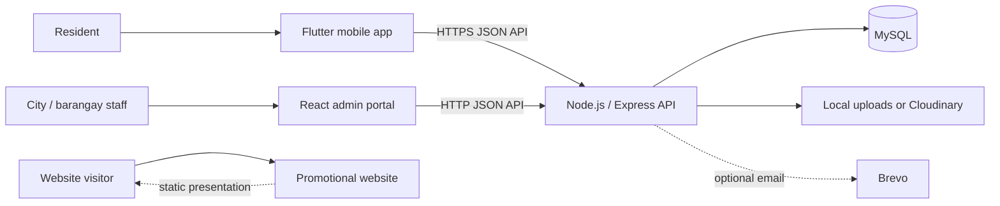

# InfraTrack

**A community infrastructure reporting and response system for Mati City, Davao Oriental.**

InfraTrack connects residents with the local teams responsible for public infrastructure. Residents can report problems and follow their progress; authorized city and barangay staff can review, assign, and update reports; administrators can publish advisories and manage the system.

The repository contains three applications and the API used by the operational apps:

| Project | Purpose | Main technologies |
| --- | --- | --- |
| [`infratrack_mobile/`](./infratrack_mobile/) | Resident-facing mobile app | Flutter, Dart |
| [`infratrack_admin/`](./infratrack_admin/) | Admin/staff web portal and REST API | React, Vite, Node.js, Express, MySQL |
| [`infratrack_website/`](./infratrack_website/) | Public-facing promotional website | React, Vite, Tailwind CSS |

> **Important:** The promotional website is a separate presentation site. Its map, phone screens, markers, and report examples are illustrative and are not live system data. The mobile app and admin portal use the API.

---

## Contents

- [What InfraTrack does](#what-infratrack-does)
- [System architecture](#system-architecture)
- [Technology stack](#technology-stack)
- [Repository layout](#repository-layout)
- [Getting started](#getting-started)
- [Configuration reference](#configuration-reference)
- [Database and uploaded media](#database-and-uploaded-media)
- [Testing and production builds](#testing-and-production-builds)
- [Deployment notes](#deployment-notes)
- [Security and operational considerations](#security-and-operational-considerations)
- [Troubleshooting](#troubleshooting)

## What InfraTrack does

### Resident mobile app

- Create an account, sign in, and maintain a resident profile.
- Submit infrastructure reports with a category, description, location, and supporting photo or video.
- Use the map and location services to help identify where an issue occurred.
- Review submitted reports and their status or progress updates.
- Receive and read notifications, including report updates and account moderation notices.
- Read city advisories and announcements. The advisory feed supports media; its top rotating feature is limited to images and GIFs.
- Complete identity verification, including document and selfie-based verification flows.
- View report and account information, including timed reporting restrictions where applicable.

### Admin and staff portal

- Review reports and inspect their submitted details and media on a map or in the issue queue.
- Update report status, severity, progress, resolution notes, and team assignment.
- Manage residents, verification status, notifications, advisories, and response teams, subject to the signed-in role and permissions.
- Publish general advisories, maintenance notices, and advertisements.
- Apply account moderation actions: warnings notify without disabling the account; suspensions can restrict reporting for a defined period; bans block account access.
- Review system activity and settings available to the current role.

### API and server

The Express server provides the JSON API for authentication, profiles, reports, media uploads, advisories, notifications, verification, moderation, staff workflows, and system data. It connects to MySQL and initializes or updates the application tables on startup.

### Promotional website

The independent Vite site explains and demonstrates the InfraTrack concept. Its showcased content is mock/sample content, not a public live-report dashboard.

## System architecture



The mobile app and portal are separate clients of the same API. The promotional website builds and deploys independently and does not connect to the live report database.

## Technology stack

| Area | Technologies |
| --- | --- |
| Mobile | Flutter, Dart, Material 3, `http`, `shared_preferences`, `camera`, `image_picker`, `geolocator`, `flutter_map`, `video_player`, Google ML Kit face detection |
| Admin frontend | React, Vite, JavaScript (ES modules), React Leaflet / Leaflet, Lucide React |
| API | Node.js, Express, JavaScript (ES modules), MySQL (`mysql2`), Multer, `ffmpeg-static`; Gemini-first AI chat with Groq-hosted Llama fallback |
| Promotional website | React, Vite, Tailwind CSS, GSAP, Lucide React |
| Database | MySQL-compatible database (for local development, XAMPP MySQL is supported) |
| Maps | OpenStreetMap tiles through the mapping libraries; internet access is required for map tiles |

## Repository layout

```text
InfraTrack/
├── infratrack_admin/       Admin frontend, Express API, API tests, and environment template
│   ├── src/                Admin React application
│   ├── server.js           API server and database initialization
│   ├── *.test.js           Node.js test files
│   ├── .env.example        Safe starting point for local configuration
│   ├── uploads/            Local uploaded media (generated; not tracked)
│   └── backups/            Local database backups (generated; not tracked)
├── infratrack_mobile/      Flutter resident application
│   ├── lib/                Dart application and screens
│   ├── assets/             Bundled HTML and image assets
│   └── test/               Flutter tests
├── infratrack_website/     Independent promotional React/Vite website
├── .github/                Repository automation and agent configuration
└── README.md               This guide
```

## Getting started

### Prerequisites

- **Node.js 20.19 or newer** and npm.
- **MySQL 8-compatible server**, such as MySQL supplied by XAMPP.
- **Flutter SDK** with a Dart SDK satisfying the constraint in [`infratrack_mobile/pubspec.yaml`](./infratrack_mobile/pubspec.yaml) (Dart 3.13.0 or newer).
- Android Studio / Android SDK for Android builds. Xcode is required to build for iOS and is available only on macOS.
- Git, if cloning the repository.

Start the local MySQL service before starting the API. The backend database account must be able to create the configured database and tables on its first run.

### 1. Start the API and admin portal

In PowerShell, from the repository root:

```powershell
Set-Location .\infratrack_admin
Copy-Item .env.example .env
npm install
```

Edit `infratrack_admin/.env` and set the local database credentials for your MySQL server. For a default local XAMPP installation, the values in `.env.example` are a starting point; set a password if your MySQL account requires one.

Start both the API and the Vite development server:

```powershell
npm run dev
```

By default, open the admin portal at **http://localhost:5173**. The API listens on **http://localhost:3001**. The API health endpoint is **http://localhost:3001/api/health**.

The chatbot requires a provider key on the API server. Set `GEMINI_API_KEY` or
`GROQ_API_KEY` in `infratrack_admin/.env` for local development. For the
production API, add one of these variables in the hosting service's environment
settings and redeploy. Never put provider keys in the Flutter app or commit them
to the repository. Without a configured key, the chatbot returns a setup message
instead of generating replies; the profile screen avoids falsely claiming that
the chatbot is online.

On Render, use these API model IDs for chat: `GEMINI_MODEL=gemini-2.5-flash`
and `GROQ_LLAMA_MODEL=llama-3.3-70b-versatile`. Do not use Gemini TTS/Gemma
or Groq prompt-guard model IDs for chat; the API maps unsupported model
overrides to compatible chat defaults.

The mobile report form can ask Gemini to assess the description, category, and
optional evidence once on submission; video analysis samples one frame. The
report stores a concise AI explanation and suggested severity for admin review.
The AI suggestion does not set the report priority: an admin reviews the
analysis and manually chooses the priority in the issue modal. Without
`GEMINI_API_KEY` or if analysis fails, the report is still submitted for admin
review with no AI findings attached. Configure `GEMINI_API_KEY` on the API
service to enable AI analysis.

For durable profile-photo uploads on hosts with ephemeral filesystems such as
Render, configure `CLOUDINARY_CLOUD_NAME` and `CLOUDINARY_UPLOAD_PRESET` in the
API service environment. Local uploads may be lost when the service restarts.

The first API startup creates the configured database and tables and may insert demonstration users, reports, teams, and advisories when the database is empty. This demo seed behavior is intended for development; read [Security and operational considerations](#security-and-operational-considerations) before exposing a fresh instance.

To run only one part:

```powershell
npm run server   # API only
npm run build    # build the admin frontend into dist/
npm run test     # run API and admin Node.js tests
```

After building the admin frontend, the API serves the generated `dist/` files as well. The Vite development server is not needed for that production-style local run.

### 2. Run the mobile app

In a second terminal:

```powershell
Set-Location .\infratrack_mobile
flutter pub get
flutter run
```

Unless overridden, Android and iOS builds use the API URL configured as the production default in `lib/api_service.dart`. To test against the API running on your computer, explicitly pass a reachable local URL:

```powershell
# Android emulator: 10.0.2.2 routes to the host computer.
flutter run --dart-define=API_BASE_URL=http://10.0.2.2:3001/api

# Physical Android/iOS device: replace this address with your computer's LAN IP.
flutter run --dart-define=API_BASE_URL=http://192.168.1.10:3001/api
```

For a physical device, the device and computer must be able to reach one another on the network, and the API server must accept connections on the required interface. Do not use `localhost` as the API host on a physical device: it refers to the device itself. Flutter web preview defaults to `http://localhost:3001/api`.

### 3. Run the promotional website

In another terminal:

```powershell
Set-Location .\infratrack_website
npm install
npm run dev
```

Vite prints the local URL when the development server starts. Create and preview a production build with:

```powershell
npm run build
npm run preview
```

The website's generated static files are written to `infratrack_website/dist/`.

## Configuration reference

The API reads environment variables from `infratrack_admin/.env`. Start from [`infratrack_admin/.env.example`](./infratrack_admin/.env.example); never commit a populated `.env` file.

| Variable | Purpose | Default / notes |
| --- | --- | --- |
| `PORT` | API listening port | `3001` |
| `DB_HOST` | MySQL hostname | `127.0.0.1` |
| `DB_PORT` | MySQL port | `3306` |
| `DB_USER` | MySQL user | `root` |
| `DB_PASSWORD` | MySQL password | Empty in the template; configure for your environment |
| `DB_NAME` | Application database name | `infratrack` |
| `DB_SSL` | Enable TLS for the MySQL connection | `false` locally; enable for a managed database when required |
| `VITE_API_URL` | Optional admin frontend API URL | Development defaults to `http://localhost:3001/api`; production defaults to same-origin `/api` |
| `CLOUDINARY_CLOUD_NAME` | Cloudinary cloud name for durable advisory media | Optional |
| `CLOUDINARY_UPLOAD_PRESET` | Cloudinary upload preset | Optional; configure durable storage for serverless deployments |
| `CLOUDINARY_API_KEY` / `CLOUDINARY_API_SECRET` | Server-side signed Cloudinary upload fallback | Optional; keep the secret server-side |
| `LOGIN_MAX_ATTEMPTS` | Login attempts allowed per IP within the server's rate-limit window | Defaults to `10` |
| `BREVO_API_KEY` | Brevo transactional email API key | Optional |
| `BREVO_SENDER_EMAIL` / `BREVO_SENDER_NAME` | Verified sender details for email | Optional; verify the sender in Brevo |
| `APP_PUBLIC_URL` | Public sign-in URL used in email links | Optional |
| `BREVO_LOGO_URL` | Public HTTPS logo URL for email templates | Optional |
| `GEMINI_API_KEY` | Google AI Studio key for the primary chatbot provider | Optional; configure on the API server |
| `GEMINI_MODEL` | Gemini model name | Defaults to `gemini-2.5-flash`; provider availability can change |
| `GROQ_API_KEY` | Groq key for the backup chatbot provider | Optional; Groq hosts the Llama model used as fallback |
| `GROQ_LLAMA_MODEL` | Llama model identifier available to your Groq account | Defaults to `llama-3.3-70b-versatile`; change if unavailable |

The mobile app has its own API setting: pass `--dart-define=API_BASE_URL=<base-url>` to Flutter when running or building. See the mobile setup above and [`infratrack_mobile/README.md`](./infratrack_mobile/README.md).

### AI chatbot provider behavior and cost

The resident chatbot sends messages to the InfraTrack API; provider keys are kept on the server and are never shipped in the mobile app. The API tries Gemini first, then a Llama model hosted by Groq if Gemini fails (including quota or rate-limit responses). If only one provider key is configured, that provider is used alone. Configure both keys for fallback, then restart/redeploy the API.

Gemini, Groq, and Llama should not be described as guaranteed-free. Providers may offer free developer tiers or promotional quotas, but availability, rate limits, eligible models, and pricing can change and may vary by account or region. Llama is an open model family, not a free hosted inference service by itself; in this setup Groq supplies the inference API. Review each provider's current pricing, quota, and usage terms before deployment. The API also limits each signed-in user to 15 chatbot messages per minute.

## Database and uploaded media

- The API creates the configured database, tables, and supported schema updates during startup. It needs database permissions to create/alter the schema.
- Keep regular database backups. The server also has a local `backups/` directory; generated backups are deliberately excluded from Git.
- Uploaded files are stored under `infratrack_admin/uploads/` when local disk storage is used. That directory is generated and excluded from Git.
- Local disk is not durable storage on many hosted/serverless platforms. Configure Cloudinary (or another persistent storage service integrated by your deployment) before relying on uploaded advisory media in such an environment.
- For durable profile-photo storage on hosted services, configure Cloudinary. Render local-disk fallback is temporary and can be lost on restart; Vercel requires persistent Cloudinary storage.
- Database rows and uploaded files are separate. Include both in a backup/restore plan if local media storage is in use.
- Never check real resident reports, identity documents, selfies, private uploads, or production database backups into the repository.

## Testing and production builds

### Admin and API

```powershell
Set-Location .\infratrack_admin
npm test
npm run build
```

The Node test runner discovers the `*.test.js` files in the admin project.

### Mobile

```powershell
Set-Location .\infratrack_mobile
dart format --output=none --set-exit-if-changed .
flutter analyze
flutter test
flutter build apk --release
```

The Android APK is generated under `infratrack_mobile/build/app/outputs/flutter-apk/`. For an iOS release, build on macOS with the required Xcode signing and provisioning configured.

### Promotional website

```powershell
Set-Location .\infratrack_website
npm run build
```

## Deployment notes

- Deploy the API with its MySQL database and required environment variables. Ensure the deployed mobile and admin clients target that API.
- The admin's Vite output is `infratrack_admin/dist/`; the Express server serves that directory when present. The API and admin portal can therefore be hosted together or deployed separately with matching API configuration.
- The Create LGU backup action generates a portable SQL dump through the API's existing MySQL connection, so it does not require a system `mysqldump` binary and works on serverless hosting such as Vercel.
- Deploy the promotional website independently as a static Vite site using `infratrack_website/dist/`.
- Set `DB_SSL=true` when required by the managed MySQL provider. Configure `TRUST_PROXY=true` only when the API is actually behind a trusted reverse proxy.
- Configure persistent media storage before using uploads on ephemeral hosting. Configure Brevo variables only if transactional email is enabled.
- Use HTTPS for deployed services. Android/iOS production builds should be built with the intended API URL and release signing configuration.
- Deployment providers, secrets, domains, database instances, and account credentials are environment-specific and are not stored in this repository.

## Security and operational considerations

- **Do not deploy the development seed accounts.** The API source contains shared demo credentials for seed accounts; on an empty database, demo users may be created automatically. Replace/remove those accounts and their credentials before making any instance accessible outside a controlled development environment. Do not publish their credentials.
- Use unique, strong credentials for database and provider accounts. Keep `.env`, API tokens, signing keys, and Cloudinary secrets out of Git and client-side bundles.
- Identity documents and selfie verification media are sensitive personal data. Restrict access, use HTTPS, protect storage and backups, and apply the retention and deletion practices required by your organization.
- Configure appropriate authentication, authorization, CORS/origin restrictions, rate limits, database permissions, and persistent backups for the production environment.
- Map tiles are provided by OpenStreetMap and require internet access. Follow the [OpenStreetMap tile usage policy](https://operations.osmfoundation.org/policies/tiles/).

## Troubleshooting

| Symptom | Checks |
| --- | --- |
| API exits during startup | Confirm MySQL is running, `.env` is in `infratrack_admin/`, credentials are correct, and the DB user can create the database and tables. |
| Admin shows API/network errors | Check that the API is listening on port `3001`, inspect `/api/health`, and check `VITE_API_URL` if you overrode it. |
| Mobile app cannot reach a local API | Use `10.0.2.2` from an Android emulator or the computer's LAN IP from a physical device; confirm network/firewall access. |
| Map tiles do not appear | Check internet access and ensure the map tile provider is reachable. |
| Uploaded files disappear after deployment | Local server disk may be ephemeral; configure durable object/media storage such as Cloudinary. |
| Flutter dependencies or SDK fail | Check the Flutter/Dart constraints in `pubspec.yaml`, then run `flutter doctor` and `flutter pub get`. |

---

<p align="center">
  <strong>InfraTrack</strong><br />
  Better reporting. Clearer follow-up. Stronger community infrastructure.
</p>
